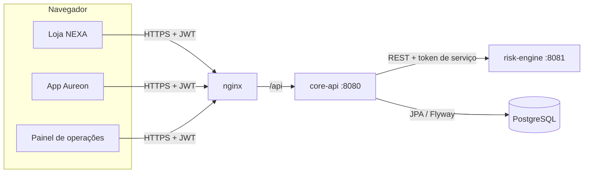

# ContextShield

Proteção contra compras com cartão induzidas por engenharia social: quando a própria vítima é guiada por um golpista (falsa central, link falso, “compra de validação”) a comprar e entregar num endereço que ele indicou.

A compra é tecnicamente legítima: cartão certo, aparelho certo, senha certa. O que denuncia o golpe é o **contexto**. O ContextShield avalia esse contexto e decide, com explicação, entre **aprovar, aprovar com aviso, pedir contexto, intervir ou bloquear**.

Projeto A3 de Sistemas Distribuídos e Mobile · Eric, Bruno e Thiago · 2026

---

## O que tem aqui

| Peça | O que faz | Tecnologia |
|---|---|---|
| `services/risk-engine` | Microsserviço **sem estado** que recebe o contexto de uma compra e devolve a decisão: 31 sinais, 11 regras, envelope de segurança, certificado de robustez e perguntas de verificação | Java 21, Spring Boot 3.5 |
| `services/core-api` | API principal: usuários, catálogo, checkout, máquina de estados da compra, relatos (“Fui vítima”), inteligência, avisos, auditoria. Chama o motor por HTTP | Java 21, Spring Boot 3.5, JPA, Flyway, PostgreSQL, JWT |
| `frontend` | Três telas: **Loja NEXA** (onde a compra acontece), **App Aureon** (o banco da cliente) e **Painel de operações** (o analista) | HTML5, CSS3 e JavaScript puro |
| `perf` | Teste de carga sem dependências (carga normal e pico) | Node 22 |
| `docs` | Arquitetura, API, testes, deploy, roteiro da apresentação, avaliação e posts | Markdown |



## Rodar com Docker (um comando)

```bash
cp .env.example .env       # troque o JWT_SECRET
docker compose up --build
```

Abra http://localhost:8088. A API documentada (Swagger) fica em http://localhost:8088/swagger-ui.html.

Na primeira subida, a core-api cria as tabelas (Flyway) e carrega a história da demonstração: 9 clientes, 28 produtos e 16 compras dos últimos dias, todas avaliadas pelo motor de verdade.

## Contas da demonstração

Todas com a senha **`contexto`**.

| Quem | E-mail | Onde |
|---|---|---|
| Ana Martins (cliente) | ana.martins@correio.example | Loja e app do banco |
| Mariana Rocha (cliente) | mariana.rocha@correio.example | Loja e app do banco |
| Lívia Moreira (analista) | analista@contextshield.example | Painel |
| Administração | admin@contextshield.example | Painel, incluindo usuários |

O roteiro da apresentação está em [docs/DEMO.md](docs/DEMO.md).

## Rodar sem Docker (desenvolvimento)

Pré-requisitos: Java 21, Maven 3.9, Node 22 e um PostgreSQL local (banco `contextshield`, usuário e senha `contextshield`).

```bash
mvn -q install -DskipTests
java -jar services/risk-engine/target/risk-engine-exec.jar        # porta 8081
java -jar services/core-api/target/core-api.jar                    # porta 8080
cd frontend && npm install && npm run dev                          # http://localhost:5173 (arquivos estáticos + proxy /api)
```

Sem PostgreSQL, suba a core-api com `--spring.profiles.active=local` (H2 em memória, em modo PostgreSQL).

O frontend não usa React. Em desenvolvimento, `npm run dev` serve os HTML e encaminha `/api` para a core-api (porta 8080), no mesmo papel do nginx em `frontend/nginx.conf`. As telas ficam em `/` (apresentação), `/loja`, `/banco`, `/ops` e `/sistema`.

## Testes

```bash
mvn verify                                   # 76 testes: motor, API, CRUD, integridade, segurança
node perf/load.mjs                           # desempenho: carga normal (10 usuários) e pico (50)
cd frontend && npm run test:unit             # formatação, catálogo, cartão e cliente HTTP
cd frontend && npm run test:smoke            # páginas abrem sem erro de JavaScript
cd frontend && npm run test:e2e              # história completa pela interface (Playwright; exige a API)
cd frontend && npm run test:a11y             # acessibilidade (axe-core, WCAG 2 AA) em 19 telas
```

Resultados e o que cada teste cobre: [docs/TESTES.md](docs/TESTES.md).

## Documentação

- [Arquitetura](docs/ARQUITETURA.md): microsserviços, dados, segurança, decisões
- [API](docs/API.md): todos os endpoints
- [Design e movimento](docs/DESIGN.md): identidade das três telas, ícones próprios, animações e acessibilidade
- [Testes](docs/TESTES.md): funcionais, desempenho, usabilidade e acessibilidade, com números
- [Deploy na nuvem](docs/DEPLOY.md): Render + PostgreSQL gerenciado
- [Roteiro da apresentação](docs/DEMO.md)
- [Avaliação do projeto](docs/AVALIACAO.md): versão original × esta versão × alternativa
- [Esboço do relatório (artigo)](docs/RELATORIO-ESBOCO.md)
- [Posts do LinkedIn](docs/LINKEDIN.md)

## Estrutura

```
.
├── pom.xml                       # build Maven multi-módulo
├── services/
│   ├── risk-engine/              # motor de risco (sem banco)
│   └── core-api/                 # API principal (PostgreSQL)
├── frontend/                     # HTML, CSS e JavaScript (sem framework)
├── perf/                         # teste de carga
├── docs/
├── docker-compose.yml
└── render.yaml                   # blueprint de deploy
```
