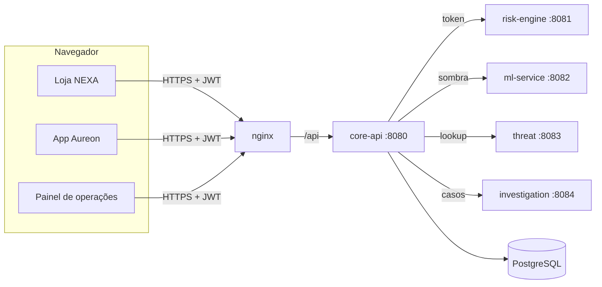

# ContextShield

Proteção contra compras com cartão induzidas por engenharia social: quando a própria vítima é guiada por um golpista (falsa central, link falso, “compra de validação”) a comprar e entregar num endereço que ele indicou.

A compra é tecnicamente legítima: cartão certo, aparelho certo, senha certa. O que denuncia o golpe é o **contexto**. O ContextShield avalia esse contexto e decide, com explicação, entre **aprovar, aprovar com aviso, pedir contexto, intervir ou bloquear**.

Projeto A3 de Sistemas Distribuídos e Mobile · Eric, Bruno e Thiago · 2026

---

## O que tem aqui

| Processo | Porta | Responsabilidade |
|---|---|---|
| `services/core-api` | 8080 | API, checkout, relatos, políticas, auditoria; orquestra os outros serviços |
| `services/risk-engine` | 8081 | **Decisão da compra** (regras R1–R12, sombra não decide) |
| `services/ml-service` | 8082 | Inferência e treino **em sombra** (`.ser` Smile 3.1.1) |
| `services/threat-service` | 8083 | Indicadores confirmados compartilhados |
| `services/investigation-service` | 8084 | Casos de investigação |
| `frontend` | 5173 / 8088 | NEXA, Aureon e Operations (HTML/CSS/JS) |

PostgreSQL: schemas `public`, `ml`, `threat`, `investigation`. Detalhes de segurança: [docs/SEGURANCA-E-ISOLAMENTO.md](docs/SEGURANCA-E-ISOLAMENTO.md).

| Auxiliar | Função |
|---|---|
| `perf` | Carga (Node) |
| `docs` | Arquitetura, deploy, apresentação |
| `scripts/aws` | Backup/restore (`.sh` Linux e `.ps1` Windows) |



## Rodar com Docker (um comando)

```bash
cp .env.example .env
# Dev: JWT_ALLOW_DEV_SECRET=true SEED_ENABLED=true no .env
docker compose up --build
```

Abra http://localhost:8088. Para EC2/AWS (só proxy público): `docker compose -f docker-compose.aws-free.yml up --build`.

Com `SEED_ENABLED=true` e perfil `dev`, a core-api pode carregar o histórico demonstrativo. Em produção (`SPRING_PROFILES_ACTIVE=prod`) o seed fica desligado.

## Contas da demonstração

Todas com a senha **`contexto`**.

| Quem | E-mail | Onde |
|---|---|---|
| Ana Martins (cliente) | ana.martins@correio.example | Loja e app do banco |
| Mariana Rocha (cliente) | mariana.rocha@correio.example | Loja e app do banco |
| Lívia Moreira (analista) | analista@contextshield.example | Painel |
| Administração | admin@contextshield.example | Painel, incluindo usuários |

O roteiro da apresentação está em [docs/DEMO.md](docs/DEMO.md).

## Rodar sem Docker (desenvolvimento)

Pré-requisitos: Java 21, Maven 3.9, Node 22 e um PostgreSQL local (banco `contextshield`, usuário e senha `contextshield`).

```bash
mvn -q install -DskipTests
# Um terminal por processo (JWT_SECRET, URLs e senhas por schema — ver .env.example)
java -jar services/risk-engine/target/risk-engine-exec.jar
java -jar services/ml-service/target/ml-service-exec.jar
java -jar services/threat-service/target/threat-service-exec.jar
java -jar services/investigation-service/target/investigation-service-exec.jar
# Core: SEED_ENABLED=true -Dspring.profiles.active=dev
java -jar services/core-api/target/core-api.jar
cd frontend && npm install && npm run dev   # http://localhost:5173
```

Sem PostgreSQL, suba a core-api com `--spring.profiles.active=local` (H2 em memória, em modo PostgreSQL).

O frontend não usa React. Em desenvolvimento, `npm run dev` serve os HTML e encaminha `/api` para a core-api (porta 8080), no mesmo papel do nginx em `frontend/nginx.conf`. As telas ficam em `/` (apresentação), `/loja`, `/banco`, `/ops` e `/sistema`.

## Testes

```bash
mvn verify                                   # 76 testes: motor, API, CRUD, integridade, segurança
node perf/load.mjs                           # desempenho: carga normal (10 usuários) e pico (50)
cd frontend && npm run test:unit             # formatação, catálogo, cartão e cliente HTTP
cd frontend && npm run test:smoke            # páginas abrem sem erro de JavaScript
cd frontend && npm run test:e2e              # história completa pela interface (Playwright; exige a API)
cd frontend && npm run test:a11y             # acessibilidade (axe-core, WCAG 2 AA) em 19 telas
```

Resultados e o que cada teste cobre: [docs/TESTES.md](docs/TESTES.md).

## Documentação

- [Arquitetura](docs/ARQUITETURA.md): microsserviços, dados, segurança, decisões
- [API](docs/API.md): todos os endpoints
- [Design e movimento](docs/DESIGN.md): identidade das três telas, ícones próprios, animações e acessibilidade
- [Testes](docs/TESTES.md): funcionais, desempenho, usabilidade e acessibilidade, com números
- [Deploy na nuvem](docs/DEPLOY.md): Render + PostgreSQL gerenciado
- [Roteiro da apresentação](docs/DEMO.md)
- [Avaliação do projeto](docs/AVALIACAO.md): versão original × esta versão × alternativa
- [Esboço do relatório (artigo)](docs/RELATORIO-ESBOCO.md)
- [Posts do LinkedIn](docs/LINKEDIN.md)

## Estrutura

```
.
├── pom.xml                       # build Maven multi-módulo
├── services/
│   ├── risk-engine/              # motor de risco (sem banco)
│   └── core-api/                 # API principal (PostgreSQL)
├── frontend/                     # HTML, CSS e JavaScript (sem framework)
├── perf/                         # teste de carga
├── docs/
├── docker-compose.yml
└── render.yaml                   # blueprint de deploy
```
