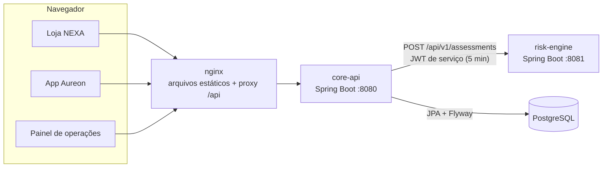
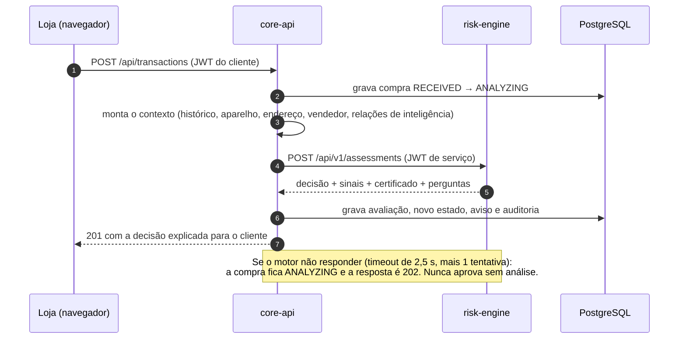
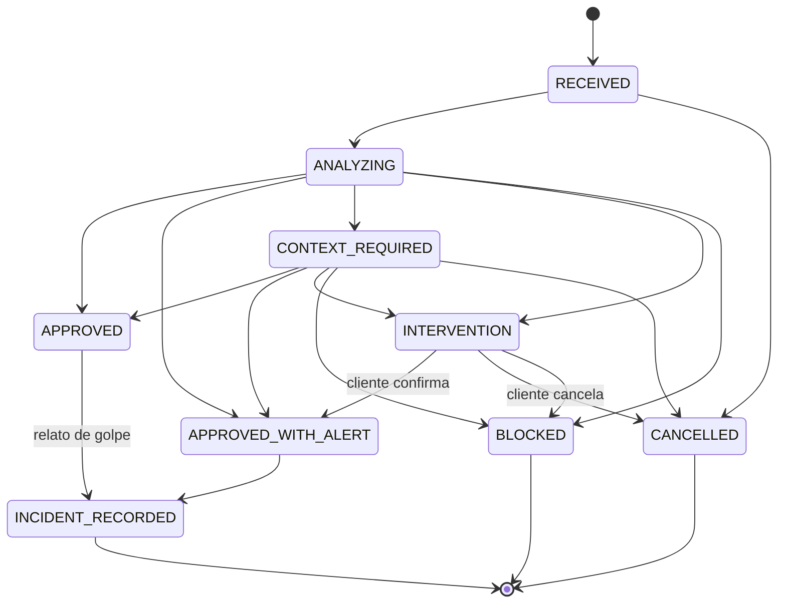

# Arquitetura

## Visão geral

O sistema é dividido em **dois microsserviços Java** e um front-end em HTML, CSS e JavaScript puro. A divisão segue uma linha simples: **quem decide** não guarda estado; **quem guarda estado** não decide.

| Serviço | Responsabilidade | Estado | Escala |
|---|---|---|---|
| **risk-engine** | Recebe o contexto completo de uma compra e devolve sinais, score, banda, decisão, envelope de segurança, certificado de robustez e plano de perguntas | Nenhum (função pura sobre a entrada) | Horizontal, sem coordenação |
| **core-api** | Usuários e login (JWT), catálogo, checkout, máquina de estados da compra, verificação, relatos, inteligência, avisos, métricas e auditoria | PostgreSQL | Horizontal atrás de balanceador; o banco é o ponto de coordenação |
| **frontend** | Três interfaces sobre a mesma API | Nenhum (token no navegador) | CDN / nginx |

### Por que dois serviços e não um, ou cinco

- **Um só** (monólito) seria mais simples, mas a A3 pede microsserviços e, mais importante, o motor de risco tem um ciclo de vida diferente: muda de regra com frequência, precisa ser auditável e é o candidato natural a ser vendido como serviço para outros bancos.
- **Cinco** (usuários, catálogo, transações, relatos, motor) criaria transações distribuídas e consistência eventual sem ganho real para o tamanho do problema. Separamos onde a fronteira é natural: decisão × registro.

## Fluxo do checkout

Quando a decisão é **pedir contexto**, a loja mostra as perguntas do plano de verificação. As respostas voltam para `POST /api/transactions/{id}/verification` e a core-api chama o motor de novo com `stage = recalculated`.

## Máquina de estados da compra

A regra está em um só lugar (`TransactionStatus.java`). Estados finais não reabrem, nem por ação do analista. Cada mudança grava uma linha em `status_change` com motivo e autor.

## O motor de risco

A lógica é a mesma do protótipo original (que rodava em JavaScript no navegador), portada para Java e conferida **caso a caso**: 43 cenários gravados do protótipo produzem exatamente os mesmos sinais, score, banda, confiança, decisão proposta, decisão final, regra e fragilidade (`ParityTest`).

1. **Sinais** (31, de 6 fontes: histórico, dispositivo, checkout, vendedor, contexto declarado, inteligência). Cada sinal tem peso, confiança e dependências.
2. **Desconto de dependência**: sinais que repetem o mesmo fato contam pela metade.
3. **Score** = base 22 + soma dos pontos, limitado a 0–100. Bandas: baixo, médio, alto, crítico.
4. **Confiança** = 30 + 9 por fonte, +10 se verificada, −10 se há conflito, −12 por fonte degradada, −8 com histórico curto (mínimo 40).
5. **Política** (regras R1 a R11) escolhe a decisão proposta.
6. **Envelope de segurança**: só pode **endurecer** a decisão, nunca afrouxar. Age quando a confiança é baixa, o certificado é frágil, fontes estão fora, uma única evidência domina, há relação com relatos ou divergência não resolvida.
7. **Certificado de robustez**: refaz a decisão com cada fonte ausente, enfraquecida ou adulterada. Se alguma perturbação muda a classe da decisão, a aprovação é marcada como frágil.
8. **Plano de verificação**: até 5 perguntas, escolhidas por gatilhos (origem por link, contato prévio, endereço desconhecido, aparelho novo, valor fora do hábito, frase de roteiro do golpista).

## Dados

Esquema versionado com Flyway (`V1__schema.sql`, `V2__indexes.sql`). Principais tabelas:

| Tabela | Conteúdo |
|---|---|
| `customer`, `app_user`, `card`, `device`, `address`, `address_owner` | Clientes, logins (senha com BCrypt), cartões, aparelhos e endereços (um endereço pode ter vários donos) |
| `merchant`, `seller`, `category`, `product` | Loja e catálogo |
| `transactions`, `transaction_item` | Compra (com `version` para trava otimista e `CHECK amount > 0`) e itens (apagados em cascata) |
| `assessment` | Cada avaliação do motor, com a resposta completa em JSON |
| `verification`, `status_change` | Respostas do cliente e histórico de estados |
| `incident`, `intel_entity`, `intel_mention` | Relatos e as entidades extraídas deles (telefone, domínio, endereço, vendedor) |
| `alert`, `audit_entry`, `engine_setting` | Avisos do app, trilha de auditoria e configuração do motor |

Integridade garantida no banco, não só no código: chaves estrangeiras, `NOT NULL`, `UNIQUE` em e-mail e `CHECK` no valor. Os testes de persistência provam que o banco recusa dados inválidos mesmo se a aplicação deixasse passar.

## Segurança

- **JWT (HS256)** emitido no login, com papel (`CUSTOMER`, `ANALYST`, `ADMIN`) e id do cliente. Validade de 2 horas.
- **Autorização por rota**: `/api/admin/**` só ADMIN; `/api/ops/**` ANALYST ou ADMIN; compras, relatos e avisos só do próprio cliente (outro cliente recebe 404, para não vazar que o id existe).
- **Serviço a serviço**: a core-api assina um JWT de serviço de 5 minutos para chamar o motor. O motor recusa token de cliente (403) e chamada sem token (401).
- Senhas com **BCrypt**. Segredos só por variável de ambiente.
- Erros com corpo uniforme `{timestamp, status, error, path, fields}`, sem stack trace.
- O front fala com a API pelo **mesmo domínio** (nginx faz o proxy), então não há CORS aberto em produção.

## Decisões e trocas

| Decisão | Alternativa considerada | Por quê |
|---|---|---|
| Motor em Java, no servidor | Manter em JS no navegador (como no protótipo) | No navegador, o cliente vê e altera a regra. E a A3 avalia a aplicação Java |
| REST síncrono entre serviços | Fila (RabbitMQ/Kafka) | O cliente precisa da decisão na hora do checkout. Fila faria sentido para o pós-processamento (relatos → inteligência) numa próxima versão |
| Falha segura (202 + ANALYZING) | Aprovar se o motor cair | Um sistema antifraude que aprova quando falha é pior que nenhum |
| Chaves de domínio como texto (`TX-2026-000184`) | IDs numéricos | São os números que aparecem para o cliente e o analista; facilitam a demonstração e a auditoria |
| PostgreSQL | MongoDB | Os dados são relacionais (cliente → compra → avaliação → relato) e a integridade importa |
